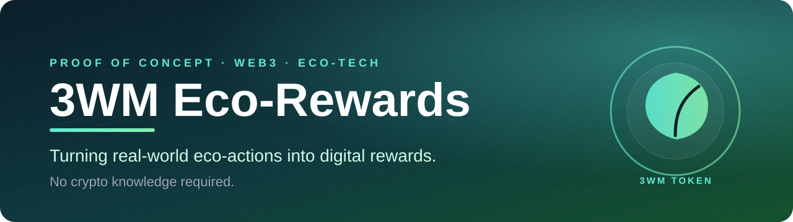
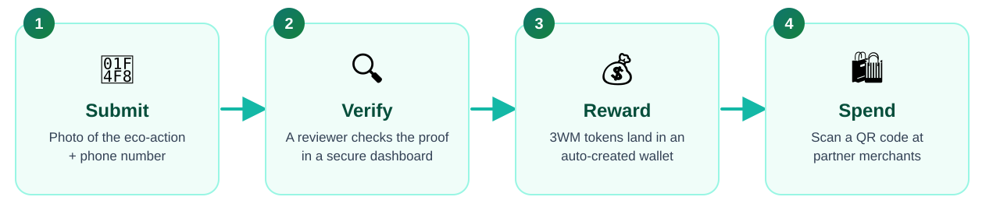
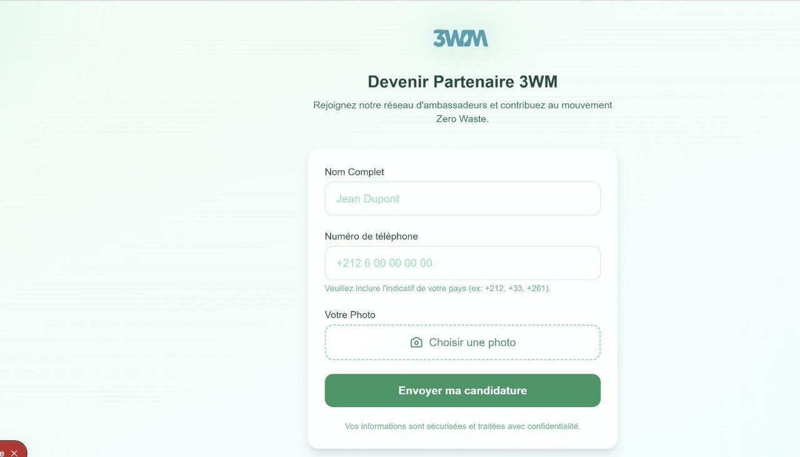
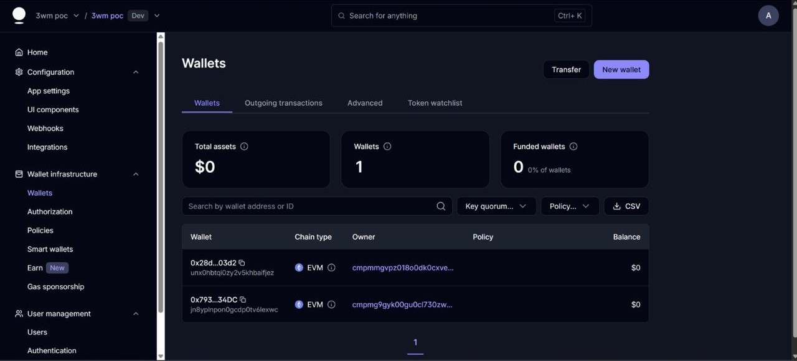

 

**[▶ Watch the demo](#-demo)** &nbsp;·&nbsp; **[The idea](#-the-idea)** &nbsp;·&nbsp; **[Screens](#-screens)** &nbsp;·&nbsp; **[Roadmap](#-roadmap)** &nbsp;·&nbsp; **[Contact](#-about-me)**

🔒 Source code is private. This page presents the idea, the UX and a live demo.

---

## 🎬 Demo

<a href="https://github.com/anass9elalaoui-netizen/3wm-eco-rewards/blob/main/media/demo.mp4"><b>▶ Click here to play the demo video</b></a>

Full walkthrough: sign-up → verification → wallet reward.

<!-- TIP: edit this README on GitHub and drag media/demo.mp4 into the editor above so the video plays inline. -->

---

## 🌍 The problem

In Madagascar, Morocco and across francophone Africa, people clean beaches, collect waste and plant trees, and **nobody notices**.

| | |
|---|---|
| 🚫 **No incentive** | Ecological effort goes unrewarded |
| 🕵️ **No proof** | Nothing verifies that an action really happened |
| 🔐 **No access to Web3** | No bank account, no MetaMask, no seed phrases |

## 💡 The idea

One simple loop that anyone with a phone can use.

> The user never sees a private key, a gas fee or a technical screen unless they ask for one.

---

## 📱 Screens

<table>
  <tr>
    <td align="center" width="50%">
      
        <b>30-second sign-up</b>
       Mobile-friendly · French UI · clear phone-prefix guidance
    </td>
    <td align="center" width="50%">
      
        <b>Wallet created automatically</b>
       One tap to copy the address · zero crypto jargon
    </td>
  </tr>
</table>

<b>🛠 Behind the scenes: wallet infrastructure</b>

 

Every new user gets an embedded wallet provisioned automatically.

---

## 🧩 What I designed and built

| 🎨 Design | ⚙️ Engineering | 🛡️ Product thinking |
|---|---|---|
| UX for non-crypto users | Auto-provisioned embedded wallets | Human verification before any reward |
| Eco brand, glassmorphism UI | Admin approval workflow | Protected admin area |
| Multilingual onboarding | On-chain token distribution (BEP-20) | Abuse and duplicate-photo risk analysis |

**Stack:** Next.js · React · TypeScript · Tailwind · Prisma · MySQL · Privy · BNB Smart Chain

The 3WM token is live and publicly verifiable on [BscScan](https://bscscan.com/address/0xd065ca6460ae6d379c93ec0422084c2bc7048d77).

## 🗺 Roadmap

- [x] Ambassador sign-up with photo upload
- [x] Embedded wallets for non-crypto users
- [x] Admin review and token airdrop
- [x] QR code for spending
- [ ] SMS one-time-password verification
- [ ] Merchant app to scan QR payments
- [ ] AI-assisted photo verification (fake and duplicate detection)
- [ ] Scalable media storage

---

## 👋 About me

**Anass El Alaoui**
 Product-minded developer building Web3 and eco-tech experiences

Want to see the code? I'm happy to walk you through it live.

