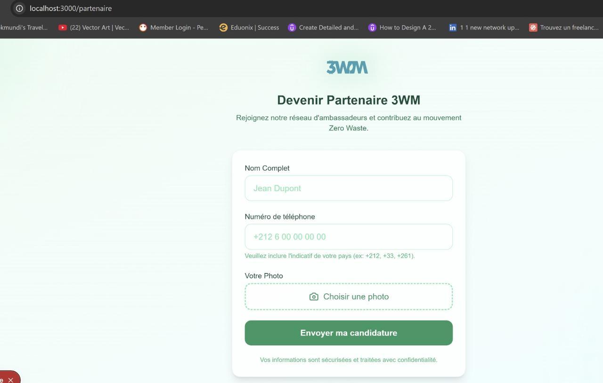
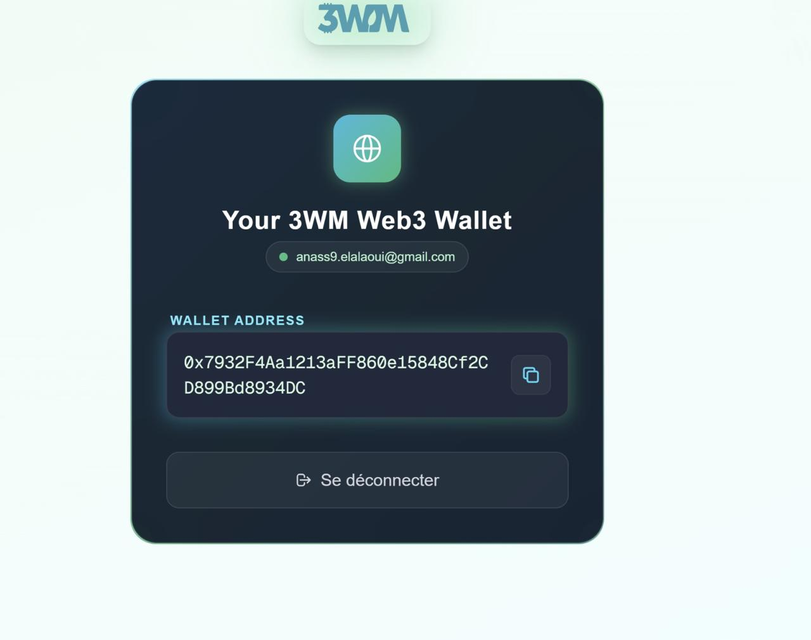
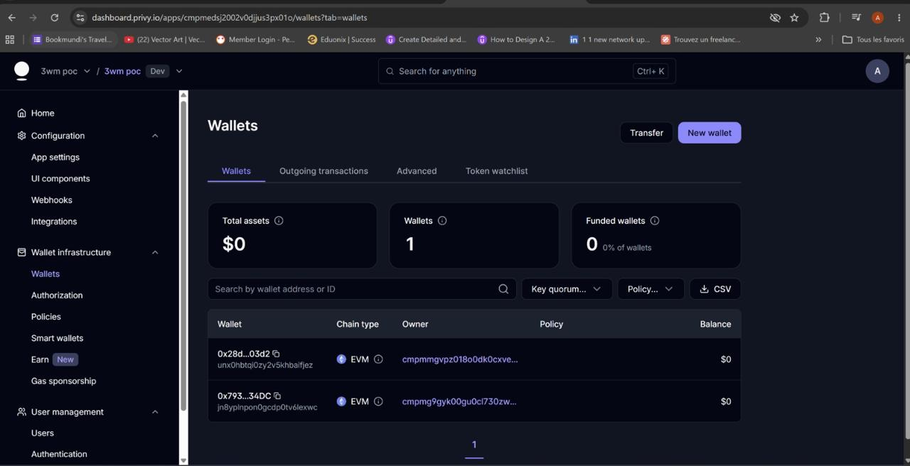

# 3WM Eco-Reward Platform (Proof of Concept)

> **Private portfolio project — all rights reserved. Not open source.**

A Web3 eco-reward platform that turns real-world ecological actions (waste collection, clean-ups, tree planting) into **3WM tokens** (BEP-20 on BNB Smart Chain) — with no crypto knowledge required from the user.

**Stack:** Next.js 16 · React · Prisma · MySQL · Privy (embedded wallets) · BNB Smart Chain

## How it works

1. A user (ambassador/partner) signs up with name, phone number and photo.
2. Privy creates a non-custodial **embedded wallet** — no MetaMask, no seed phrase.
3. An admin reviews submissions in a protected dashboard and approves them.
4. Approved actions trigger an on-chain **3WM token airdrop** to the user's wallet.

## Demo

Screen recording of the full flow: [`docs/media/demo.mp4`](docs/media/demo.mp4)

## Screenshots

| Partner sign-up | Embedded Web3 wallet |
|---|---|
|  |  |

**Privy dashboard — wallets provisioned automatically for users**



## Highlights

- Email/social login with auto-provisioned embedded wallets (Privy)
- Admin dashboard with approval workflow, balance checks and token distribution
- Route protection through `proxy.ts` (Next.js 16)
- Ambassador module with photo upload and phone validation (international prefixes)
- Prisma schema + MySQL, deployable on Hostinger

Full architecture, API reference and flows: [`PROJECT_OVERVIEW.md`](PROJECT_OVERVIEW.md).

## Run locally

```bash
cp .env.example .env   # fill in your own values
npm install
npx prisma generate
npm run dev
```

## License

Copyright © Anass El Alaoui. All rights reserved. No permission is granted to use, copy, modify or distribute this code.
